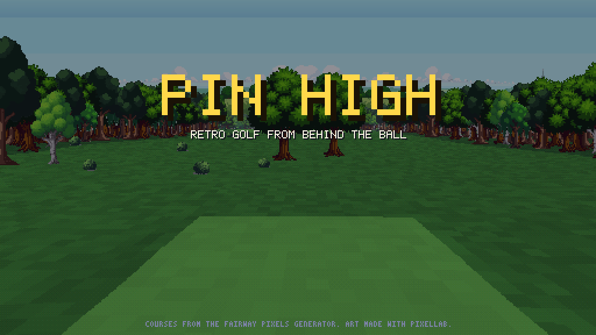

# Pin High

A retro golf game played from behind the golfer, in the spirit of the mid-80s pseudo-3D golf games, with modern pixel art. The courses come from the course generator in Fairway Pixels (`davebulwer-web/golf`), so every seed and style gives a new 18 holes. The golfer stands side on, as in the originals, and every shot (putts too) uses the same camera, set so he draws at the art's own pixel size with hills, doglegs, bunkers, water and woods.

## Playing

Download `pin-high.html` and open it in a browser. It's one self-contained file.

Pick 1 to 4 players (each with a name and shirt colour), a level, and a course: either one of the named courses from Fairway Pixels' course list, or a random course from any of the eight styles (parkland, links, desert, heathland, alpine, tropical, woodland, stadium) and a seed. Then play 18 holes, the front 9 or the back 9 from the forward, white, blue or championship tees.

Game types:

- **Stroke play:** fewest strokes over the round wins.
- **Match play** (2 players): win, lose or halve each hole. The match ends as soon as one player is more holes up than there are holes left ("3 & 2"), and a player who can no longer halve a hole picks up.
- **Skins** (2 to 4 players): the outright best score takes the hole's skin; a tie carries it over to the next hole.
- **Stableford:** points for each hole (double bogey or worse 0, bogey 1, par 2, birdie 3, eagle 4). You pick up once you can't score.
- **Practice hole:** pick any hole and play it as often as you like. `U` takes your last shot again (a mulligan), and after holing out Space plays the hole again and `N` moves to the next one.
- **Driving range:** the flattest long hole on the course, with flags every 50 yards. Hit any club as often as you like: your club and aim stay set, and after each shot you see the carry, the total and how far left or right it finished. `N` moves to another hole.
- **Putting green:** random putts of 12 to 45 feet on each green, with made/attempted in the panel. `U` tries the same putt again and `N` moves to the next green.

- **Aim:** left/right arrows (hold Shift for fine aim), or drag sideways on the view. The view turns with your aim, and the yellow marker shows where a full shot with that club carries on flat, calm ground.
- **Club:** up/down arrows or the mouse wheel. A club is picked for you each shot, and the panel shows how far it carries from your lie on flat, calm ground. While you swing, the meter shows the power and the yards that power gives. On the green, up/down changes the putter's range (9 to 108 feet).
- **Swing:** hold space (or the mouse button on the view) and the power climbs up the meter; let go to set it (past 100% is an overswing: longer but wild). The marker then drops into the SNAP section at the bottom of the meter: press as it crosses the white snap line. Early hooks the ball left, late slices it right, so a deliberate early or late snap is how you draw or fade a shot. The green band is how forgiving the snap is at your level.
- **Putting:** power only: hold and let go. The marker by the hole is a little post whose shadow falls the way the green slopes, longer where it's steeper. The panel shows how far up or down the hole is, and Novices get a tick on the meter for the hole's distance on a flat green.
- **Wind:** the compass shows it relative to your aim. Novice has no wind.
- **Ball cam:** once the golfer has finished his swing the camera chases the ball: close behind a putt, and above and behind a full shot. `C` turns it off for full shots (putts always follow).
- `Tab` shows the scorecard, `M` turns sound off, `Esc` goes back to the title. Holding space during a shot speeds it up.

**Lies** cut the distance by a percentage, shown in red under the club: fringe 95-98%, light rough (close to the fairway or green) 82-92%, deep rough 60-75%, fairway bunker 70-85%, greenside bunker 55-70%, waste ground 80-90%, and under trees 40-60%. The club yardage uses the middle of the range; the shot itself lands somewhere inside it. The driver also loses distance off anything but a tee.

Whoever is farthest from the hole plays next; the best score on a hole has the honour on the next tee. Water costs a stroke (drop back on dry land), out of bounds (past the woods at the edge of the hole) is stroke and distance, and you pick up after ten.

Levels: **Novice** (no wind, wide snap band, slower meter, putting line), **Amateur** (wind), **Pro** (stronger wind, tight snap, faster meter).

## How it works

Plain JavaScript and a canvas, no engine or libraries.

- `src/gen/`: the course generator and its helpers, copied unchanged from Fairway Pixels (`course-generator.js`, `course.js`, `course-map.js`, `terrain.js`, `weather.js`, `course-list.js`, at commit `ebb5758`). If the generator changes there, copy these files across again.
- `src/world.js`: turns a generated hole into a one-yard grid of surfaces and heights, plus the trees and bushes standing on it.
- `src/render.js`: the 3D view. The ground is drawn like a voxel-landscape engine: each screen column marches out from the camera and fills upwards wherever the ground shows, so hills hide what's behind them. Trees, the flag and the ball are scaled sprites tested against a depth buffer. Colours are lit from the slope, lightly dithered and fade into the haze.
- `src/physics.js`: clubs, ball flight (drag, backspin lift, side spin from the snap, wind), bounces, rolling down slopes, trees, water, out of bounds and the cup.
- `src/main.js`: the game: menus, turns, the swing meter, the panel, the minimap and the scorecard.
- `src/styles.js`: ground colours, trees and haze for each course style.
- `src/sprites.js`, `src/assets.js`: the art (packed by `tools/pack-assets.py`); golfers are recoloured per player.
- `src/font.js`, `src/logo.js`: bitmap fonts and the title logo (drawn in code).
- `src/audio.js`, `src/sounds.js`: recorded sound effects (driver, iron, chip, bunker and putt strikes, bounces, trees, water, the cup, applause, clubs) with a few synthesised ones for the swing and menus. The chosen recordings are in `assets/sounds`; `python3 tools/pack-sounds.py` packs them (add `--from <folder of .wav files>` to re-pick from the originals).

`index.html` loads the modules directly (needs a local web server, e.g. `npx serve`). After changing anything in `src/`, rebuild the single file with `node tools/build.mjs`. `node tools/shots.cjs` and `node tools/shots2.cjs` save screenshots (they need Playwright).

## Art

All the art was made with [Pixellab](https://pixellab.ai): the golfer's address pose, swing and putting stroke (animated from the address pose), eleven trees, four bushes, the flag, a horizon backdrop for each course style, and the three title screen pictures (`assets/raw/title`), which crossfade behind the logo. The swing is side on with the arms extended to the ball and the head down on it until impact: the backswing and putting stroke are posed with Pixellab's skeleton animation (`tools/skeleton-swing.py`, one skeleton per frame), and the follow-through turns into a finish seen from behind (`tools/finish-pose.py`, joined to impact with Pixellab's first-and-last-frame animation in `tools/follow-through.py`). The originals are in `assets/raw`; `tools/pl.py`, `tools/gen-scenery.sh` and `tools/gen-backdrops.sh` regenerate them (they need `PIXELLAB_API_KEY`), and `python3 tools/pack-assets.py` packs them into `src/assets.js`.

